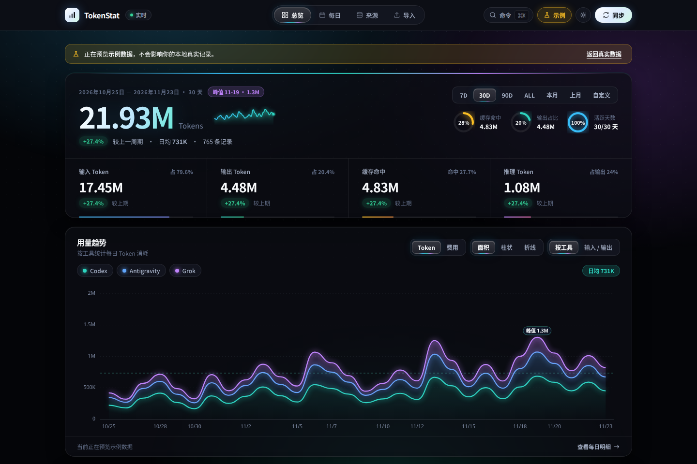

# TokenStat

[简体中文](README.md) · [Download desktop builds](https://github.com/stonehfzs/TokenStat/releases/latest)

TokenStat is a local AI token usage dashboard for Windows, macOS, and Linux.

## Highlights

- **Live collection** reads local usage from nine AI tools, including Kilo Code and OpenCode.
- **Daily insights** show token usage by tool, exact model, hour, and device.
- **API costs and budgets** provide USD or CNY estimates and desktop alerts.
- **Encrypted device sync** shares monthly usage through a shared folder.
- **Imports and backups** support CSV export, import undo, and configuration restore.
- **Desktop and tray** keep collection running with the window closed.

[See features in detail](#features-in-detail)



## Run TokenStat

The desktop installers bundle Electron. On Linux, give the AppImage execute permission before opening it. If FUSE is unavailable, launch it with `--appimage-extract-and-run`. [Windows installation and login startup](docs/WINDOWS.md)

### Confirm that collection is working

1. Open **Sources** and check the tool's connection status and **Last collected** time. The tool card shows how many files were read after the first scan.
2. Open **Daily**, select a recent date when you used the tool, and look for the tool, model, and token usage.
3. If usage is zero, return to **Sources** and check the file and skipped-entry counts. Open **Collection issues** for details. If the log path is wrong, enter the correct one and choose **Save and scan**.

### Run from source

Run the local service from source with **Node.js 22.15 or later**.

```sh
npm start
```

Open the loopback address printed in the terminal. The default is `http://127.0.0.1:4317`. Set `TOKENSTAT_PORT` to change it.

Install the desktop dependencies before opening the desktop window or building a native package.

```sh
npm ci
npm test
npm run desktop
npm run dist
```

Run `npm run dist` on the target OS to produce an NSIS installer, a DMG, or an AppImage in `dist/`. The CI matrix builds and checks packages on Linux, Windows, and macOS.

## Features in detail

### Usage and imports

| Tool | Local source |
| --- | --- |
| Codex | Session and archived-session JSONL logs under `~/.codex` or `CODEX_HOME`, including Zstandard-compressed archives |
| Google Antigravity | Usage entries in the local Antigravity App, IDE, and CLI transcripts |
| Grok Build | `updates.jsonl` in Grok session and archived-session directories |
| Claude Code | Assistant usage in JSONL project logs, including cache reads and writes |
| Gemini CLI | Local session JSON and JSONL under `~/.gemini/tmp` |
| Cline | Editor task messages and SDK, CLI, or desktop session message files |
| Roo Code | Request usage in local editor task logs |
| Kilo Code | Local Kilo SQLite databases and legacy `kilocode.kilo-code/tasks` editor logs. [Kilo database architecture](https://kilo.ai/docs/contributing/architecture/cli-runtime) |
| OpenCode | SQLite and legacy session JSON in `OPENCODE_DATA_DIR` or `$XDG_DATA_HOME/opencode` (default `~/.local/share/opencode`). A custom database file also works. [OpenCode database paths](https://github.com/anomalyco/opencode/blob/dev/packages/core/src/database/database.ts) |

TokenStat updates the dashboard when it detects new usage in a supported log. Under **Sources**, enter a custom log directory or supported file.

In **Overview**, choose a rolling range, this month, last month, or custom dates. The selection applies to totals, breakdowns, rankings, and exports. Toggle the trend between tokens and estimated cost. The cost tooltip shows pricing coverage when some usage is unpriced. In **Daily**, the 15 busiest sessions show cache hit rates and estimated costs. Sessions with at least 100,000 input tokens and a hit rate below 10% show a **Low cache** label. Timestamped records use the reporting time zone. Date-only imports retain their original calendar day.

Import UTF-8 CSV, JSON, JSONL, or NDJSON. The preview shows new records, duplicates, and model assignments. **Import history** can undo records added by a specific batch. Export the selected day or date range to CSV. **Export report PNG** draws a local summary with metrics, top tools and models, and a miniature trend.

```csv
date,provider,model,input,output,cached,cache_write,reasoning,total
2026-11-22,gemini,gemini-2.5-pro,1200,300,200,0,55,1500
```

Use `YYYY-MM-DD` or an ISO timestamp with an offset. For an API response without a timestamp, add `date` before importing. Use `request_level=true` only for a record that describes a single request. TokenStat uses that flag when a model has different short- and long-context rates.

### Terminal summary

Run `node cli.mjs` or `npm run summary` from the project directory. The default is today. `--week` starts on Monday, `--month` starts on the first of the month, and `--days N` includes today in the rolling range.

```sh
node cli.mjs --month
npm run --silent summary -- --today --no-scan --json
node cli.mjs --days 14 --data-dir /path/to/data --tz Asia/Shanghai
```

`--json` writes structured output to stdout. Costs and savings use the reported `currency`. `--no-scan` reads the existing SQLite cache for fast status-bar updates. A standard scan runs against a temporary SQLite copy. Use `--data-dir` to point at the directory containing `tokenstat.db`. The default follows the browser service's data directory configuration.

### API costs and budgets

Use **Sources → Preferences and budgets** to set daily or monthly limits for token usage or estimated API costs. The Overview progress bars show the current day and month, and open budget settings when clicked. Supply a CNY-per-USD rate to display costs in CNY. Pricing and cost budgets use USD internally. The desktop app can notify you at the 80% and 100% budget thresholds.

**Sources → Model rates** lets you override pricing for an exact tool and model ID. API estimates use public standard text rates and account for model-specific context tiers when request-level data is available. The coverage indicator shows how much usage could be priced. Grok Build charges recorded in its logs appear separately. [OpenAI pricing](https://developers.openai.com/api/docs/pricing) · [Gemini pricing](https://aistudio.google.com/docs/pricing) · [Anthropic pricing](https://platform.claude.com/docs/en/about-claude/pricing) · [xAI pricing](https://docs.x.ai/developers/pricing)

Expand **Unpriced** on the cost card or in the model breakdown to see affected request counts, token counts, and reasons.

### Encrypted device sync

1. On each device, open **Sources → Device sync** and choose the local path to the same shared folder. This can be a network share or a folder replicated by your preferred sync service.
2. On the first device, enter a device name and choose **Enable and sync** with the key field blank. Enter the generated pairing key on the other devices. **View key** reveals it when you need to pair another computer.
3. Open the device selector to filter usage or compare device totals. **All devices** counts a repeated event once. Use **Remove local copy** to stop receiving a device and remove its synced usage from this computer. **Resume receiving** reverses that setting.

Use **Verify and repair sync** to check historical months for each device and rebuild missing or damaged files owned by this computer. The report lists affected months and their reasons. Run the repair on the owning device for its files.

TokenStat writes AES-256-GCM encrypted usage files grouped by UTC month. The manifest identifies the complete set of files for a device revision. When a shared folder is unavailable or still downloading a revision, TokenStat keeps the last complete usage. Pausing sync keeps the device data already received.

Syncing Kilo Code or OpenCode usage requires TokenStat 1.6 or later on both devices.

The desktop app protects pairing keys with the operating system credential store. Linux desktop sync requires an available, unlocked credential store. Browser mode stores its pairing key in the local application data. Share the key only with computers you want to pair.

### Backups and local storage

Use **Sources → Configuration backup** to export custom log paths, rate overrides, preferences, import history, and imported usage. For a large backup, download every JSON volume. When restoring, select one backup file or all volumes from the same backup, then review verification, new and duplicate records, and settings changes before confirming. Device sync credentials and received peer snapshots stay with the installation. Keep the exported JSON private because it contains local paths and imported usage.

Volumes are staged under private `backup-transfers/` storage inside the data directory. On startup, the service clears expired directories left by processes that have exited.

TokenStat stores normalized usage and scan state in `tokenstat.db` using SQLite WAL. Conversation text remains in the AI tools’ logs. Browser-mode data directories are listed below. Set `TOKENSTAT_DATA_DIR` to override them. The desktop app uses the `data` subdirectory of its Electron user data folder.

| OS | Browser-mode data directory |
| --- | --- |
| Windows | `%LOCALAPPDATA%\TokenStat` |
| macOS | `~/Library/Application Support/TokenStat` |
| Linux | `${XDG_DATA_HOME:-~/.local/share}/tokenstat` |

Before upgrading an existing database schema, TokenStat saves a standalone SQLite copy under `migration-backups/` in the data directory. Filenames identify the schema versions and timestamp. TokenStat keeps the five most recent copies. To roll back, copy the matching backup into a separate data directory as `tokenstat.db` and start the corresponding older version with that directory.

### Desktop controls and appearance

TokenStat keeps collecting logs in the tray when the window is closed. The tray shows today's token usage and estimated cost. Use its menu to sync immediately, reopen the window at its saved size and position, or stop collection. **Start at login** is off by default. Enable it to launch TokenStat in the tray when you sign in.

The desktop window and browser dashboard offer Simplified Chinese, English, and light and dark themes. Set **Visual effects** to **Lite** in preferences for less motion. TokenStat follows the system's reduced-motion setting and pauses background animation when unfocused or hidden.
