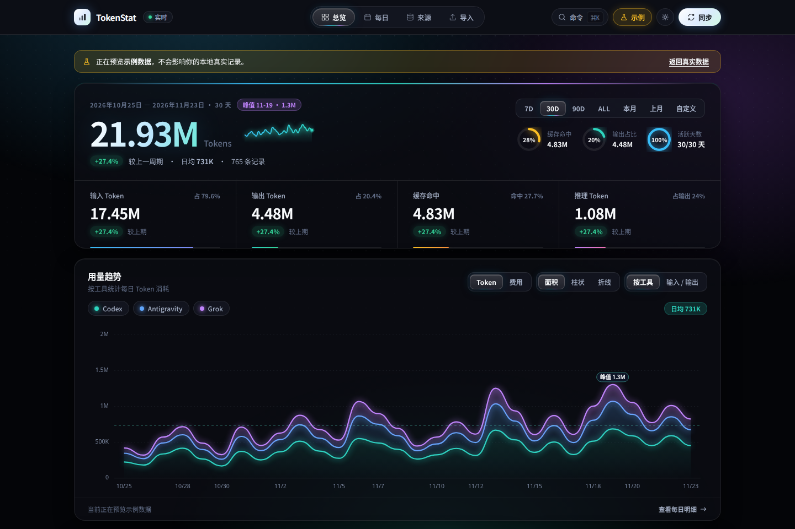

# TokenStat

[English](README.en.md) · [下载 Windows 和 Linux 桌面版](https://github.com/stonehfzs/TokenStat/releases/latest)

TokenStat 把多种 AI 工具的本地 Token 用量汇总到一个面板，支持 Windows、macOS 和 Linux。

## 亮点

- **用量自动更新。** 读取 Codex、Antigravity、Claude Code、Kilo Code 和 OpenCode 等九种工具的本地用量。
- **查到具体模型。** 按日、工具、模型和设备看用量，还能查看小时分布和会话排行。
- **估算费用、设置预算。** 支持自定义单价和 USD/CNY 显示，桌面版可设置日预算和月预算。
- **跨设备加密同步。** 通过共享文件夹合并多台电脑的记录，自动去重。
- **关窗后继续统计。** 托盘可查看今日用量，支持登录后静默启动。
- **数据可迁移。** 支持导入预检、按批撤回、CSV 导出和 JSON 配置备份。

[查看功能详解](#功能详解)



## 快速开始

### 使用桌面版

下载对应平台的安装包或 AppImage 后启动。首次打开进入「每日记录」，到「来源」可查看检测到的工具，或设置日志路径。

安装包内含 Electron 运行时。Linux 可先对 AppImage 执行 `chmod +x` 再运行。缺少 FUSE 时可用 `NO_CLEANUP=1 ./TokenStat-1.6.0-x86_64.AppImage --appimage-extract-and-run` 启动，重复启动会复用解包缓存。[Windows 安装与登录启动](docs/WINDOWS.md) · [AppImage 的 FUSE 兼容方式](https://docs.appimage.org/user-guide/troubleshooting/fuse.html)

### 安装后如何确认采集成功

1. 打开「来源」，在工具卡片上确认连接状态和「最后成功采集」时间。首次扫描结束后，卡片会显示读取的文件数。
2. 打开「每日」，选择最近一次已知使用该工具的日期，核对对应的工具、模型和 Token 用量。
3. 如果显示 0 Token，回到「来源」查看是否读到了日志，以及是否有失败或跳过的条目。有异常时可展开「查看失败与跳过原因」。如果路径有误，填写实际日志路径并点「保存并扫描」。

### 从源码运行本机面板

安装 Node.js **22.15 或更高版本**后，在项目目录运行下方命令。

```sh
npm start
```

在浏览器打开终端打印的地址，默认是 `http://127.0.0.1:4317`。这种模式只需要 Node.js。按 `Ctrl+C` 停止服务。端口占用时，可以按下方示例设置 `TOKENSTAT_PORT` 后重试。

```sh
# macOS / Linux
TOKENSTAT_PORT=4320 npm start
```

```powershell
# Windows PowerShell
$env:TOKENSTAT_PORT = '4320'
npm start
```

## 功能详解

### 本地采集与用量分析

在「总览」可按本月、上月、滚动天数或自定义日期查看汇总、分布、排行和明细。趋势图支持 Token 和估算费用视角，悬停可查看当日计价覆盖率。CSV 和报告图使用所选周期。打开「每日」选择日期，可查看 24 小时用量分布和当天用量最高的 15 个会话，每个会话显示缓存命中率和可估算的 API 费用。输入至少 10 万 Token 且缓存命中率低于 10% 时会显示「低缓存」。

有效日志发生变化后，面板自动更新。监听事件合并后仅处理变化的日志，监听正常时每 5 分钟复查目录，监听不可用时每 60 秒复查。如需读取其他位置的日志，在「来源」填写目录或文件路径。

带时间戳的日志按面板时区归入日历日，默认采用本机时区。仅有年月日的导入记录保留原日期，参与每日汇总。小时分布使用有时间戳的记录。会话使用散列标识显示。

| 工具 | 本地自动采集 |
| --- | --- |
| Gemini / Google Antigravity | 读取 `~/.gemini/{antigravity,antigravity-ide,antigravity-cli}/brain/*/.system_generated/logs/transcript.jsonl` 中带用量的记录，覆盖 Antigravity App、IDE 和 CLI。自定义路径时可填 `~/.gemini/antigravity/brain`。[Antigravity 日志路径文档](https://antigravity.google/docs/hooks?tab=ide#common-input-fields) |
| Codex | 扫描 `~/.codex/sessions` 与 `~/.codex/archived_sessions` 内的用量记录，支持 `.jsonl` 和 `.jsonl.zst`，兼容 `CODEX_HOME`。 |
| Grok Build | 扫描 `~/.grok/sessions` 与 `~/.grok/archived_sessions` 中的 `updates.jsonl`，兼容 `GROK_HOME`。[Grok Build 会话文档](https://github.com/xai-org/grok-build/blob/main/crates/codegen/xai-grok-pager/docs/user-guide/17-sessions.md) |
| Claude Code | 读取 `~/.claude/projects` 下的 JSONL 助手用量，合并同一消息的流式快照，保留缓存读取和写入数量。 [Claude 缓存字段文档](https://platform.claude.com/docs/en/build-with-claude/prompt-caching) |
| Gemini CLI | 读取 `~/.gemini/tmp` 下的会话 JSON 与 JSONL，以 Gemini CLI 独立显示。 [Gemini CLI 会话文档](https://github.com/google-gemini/gemini-cli/blob/main/docs/cli/session-management.md) |
| Cline | 读取编辑器扩展任务里的 `ui_messages.json`，以及 Cline SDK、CLI 和桌面端的 `*.messages.json`。 [Cline 会话存储](https://github.com/cline/cline/blob/main/sdk/packages/core/src/services/session-data.ts) |
| Roo Code | 读取本机编辑器扩展任务里的请求用量。部分旧版日志的字段语义必须可识别，才能归入统计。 [Roo Code 请求记录代码](https://github.com/RooCodeInc/Roo-Code/blob/main/src/core/task/Task.ts) |
| Kilo Code | 读取 Kilo SQLite 数据库和旧版 VS Code 扩展的 `kilocode.kilo-code/tasks` 任务日志。 [Kilo 本地数据库](https://kilo.ai/docs/contributing/architecture/cli-runtime) · [旧版任务记录](https://github.com/Kilo-Org/kilocode-legacy/blob/main/src/core/task/Task.ts) |
| OpenCode | 读取 `OPENCODE_DATA_DIR` 或 `$XDG_DATA_HOME/opencode`（默认为 `~/.local/share/opencode`）的 SQLite 与旧版会话 JSON，也可指定数据库文件。 [OpenCode 数据库路径](https://github.com/anomalyco/opencode/blob/dev/packages/core/src/database/database.ts) |

`~` 代表运行程序的用户主目录。如果工具在 WSL、容器或远程机器上运行，把会话文件复制到本机并配置对应路径，或在日志所在环境运行 TokenStat。网页聊天与云端账号只能通过已有的用量记录导入，面板无须登录或填写 API 密钥。Token 总量采用来源记录的口径，缓存和推理字段可能已包含在总量中。

Antigravity 的输入统计包含缓存读取，总量是输入与输出之和。程序优先采用用量日志中的模型标识，也可使用同一会话的本地生成记录核对模型。无法核实模型的用量仍计入工具及当天总量，并单列为「模型未记录」。日志未提供独立推理用量时，推理栏显示 —。[Antigravity 用量字段文档](https://antigravity.google/docs/cli/headless/)

Codex 使用逐响应记录统计新版日志，旧版日志则使用累计快照的增量。自动审核用量按日志中的 `codex-auto-review` 路由单列。Grok 使用每轮的模型用量明细，回合总量里无法归属到模型的部分会单列。

### 费用估算与预算提醒

在「每日」可查看各模型的 API 等值估算、计价覆盖率，以及普通输入、缓存读写、输出和已记录推理的费用组成。在「来源 → 模型单价」可按工具和完整模型 ID 覆盖固定费率，单位为每百万 Token 的美元价格。推理单价留空时沿用输出单价。缓存净节省按同一上下文档位的普通输入费率比较缓存读写费用。

公开价目表支持已核对的供应商前缀和模型版本。用量明细保留日志中的完整模型 ID。在「来源 → 偏好与预算」可切换中文或英文，也可填写自定义汇率并切换 USD 或 CNY 显示。自定义单价和金额预算仍使用 USD。

内置单价采用 2026 年 11 月 22 日核对的公开标准 API 文本费率。支持的长上下文模型按每次请求的输入量判断档位，再按日汇总。OpenAI GPT-6.2 Sol 的长上下文档位适用于超过 272,000 个输入 Token 的单次请求。审核路由、缺少请求级数据的分档模型，以及需要缓存写入期限等信息的记录会影响估算覆盖率。实际支付金额还取决于订阅、免费额度、所选服务、区域和工具调用。 [OpenAI 定价](https://developers.openai.com/api/docs/pricing) · [Gemini 定价](https://aistudio.google.com/docs/pricing) · [Anthropic 定价](https://platform.claude.com/docs/en/about-claude/pricing) · [xAI 定价](https://docs.x.ai/developers/pricing)

Grok Build 日志明确记录的费用单独显示，按来源的 ticks 换算为美元。此金额与公开 API 等值估算分别展示。 [Grok Build 用量说明](https://github.com/xai-org/grok-build/blob/main/crates/codegen/xai-grok-pager/docs/user-guide/14-headless-mode.md)

展开费用卡或模型明细中的「未计价」，可查看对应的记录数、Token 数和原因。

「来源 → 偏好与预算」支持每日和每月的 Token 与 API 等值费用预算。总览中的进度条始终显示当前自然日和自然月的用量，点击可直达设置。桌面端同一周期内每个 80% 和 100% 档位提醒一次。费用进度和提醒使用已计价用量。macOS 桌面应用需要代码签名才能显示原生通知。

### 跨设备同步

在每台设备上打开「来源 → 跨设备同步」。选择各自能访问的同一个共享文件夹，各平台的本地路径可以不同。

1. 在第一台设备选择文件夹，填写设备名称，密钥留空后点「启用并同步」。应用会生成配对密钥。
2. 在 Windows 或其他设备安装 TokenStat，选择同一个共享文件夹，把配对密钥粘贴进去并启用同步。已有密钥可以通过「查看密钥」再次读取。
3. 在设置卡片查看已收到的设备。后台会定期检查共享目录，点击「立即同步」可手动检查。

点「校验并修复同步」可核对各设备的历史月份，并从本机数据库重建本机缺失或损坏的分片。查看报告中的异常月份和原因，对端分片请在对应设备上修复。

共享目录可以是两端可访问的局域网共享文件夹，或通过自己的文件同步工具在设备间复制的文件夹。应用使用 AES-256-GCM，按 UTC 月份写入用量分片。未变更的历史月份可以复用，接收端验证变更分片后再合并。桌面端使用系统密钥库保护配对密钥。浏览器运行模式将密钥保存在本机应用数据中。请只把密钥交给需要配对的设备。

合并视图会对相同记录去重，导入撤回也会同步。总览和每日页面可按设备筛选，总览提供最近 30 天设备贡献。可清理已退役设备的本机副本，之后也能恢复接收。暂停或离线期间保留上次合并的用量。新版能读取旧快照，各设备升级至 1.5 后即可彼此接收新版分片。

要同步 Kilo Code 或 OpenCode 用量，发送和接收设备都需要 TokenStat 1.6 或更新版本。

### 导入与导出

支持 UTF-8 CSV、JSON、JSONL 和 NDJSON。JSONL 与 NDJSON 每行放置一个用量对象。选完文件后可预检新增数、重复数和模型分布。确认导入后可从历史撤回该批次新增的记录。

```csv
date,provider,model,input,output,cached,reasoning,total
2026-11-21,gemini,gemini-2.5-pro,1200,240,300,60,1500
2026-11-21,grok,grok-4,1750,280,420,30,2030
```

`date` 支持 `YYYY-MM-DD` 或带时区的 ISO 时间戳。`input`、`output`、`total` 至少需要一项。输入含缓存，输出含推理，另可提供 `cache_write`。只有单次 API 请求记录才可标记 `request_level=true`，以使用按请求区分的长上下文费率。工具标识使用 `codex`、`gemini`、`grok`、`claude`、`gemini-cli`、`cline`、`roo` 或 `other`，也可在导入时选择。JSON 可以是同字段的记录数组，也可以使用下方带日期与模型名的 API 用量格式。

```json
[
  {
    "date": "2026-11-21T10:30:00+08:00",
    "provider": "grok",
    "model": "grok-4",
    "usage": {"prompt_tokens": 1750, "completion_tokens": 280, "total_tokens": 2030}
  }
]
```

导入支持包含 `usage` 的 OpenAI、xAI 与 Anthropic 格式，以及包含 `usageMetadata` 的 Gemini 格式。API 响应缺少时间时，可加上 `date` 字段再导入。

在「总览」点「导出 CSV」可导出所选统计周期的用量，在「每日」点「导出当天」可导出选中日期。「导出报告图」在本机生成 PNG，包含汇总指标、工具和模型排行及小型趋势图。

### 终端速查

在项目目录运行 `node cli.mjs` 或 `npm run summary`。默认统计当天，`--week` 从本周一算起，`--month` 从本月 1 日算起，`--days N` 统计包含今天的最近 N 天。

```sh
node cli.mjs --month
npm run --silent summary -- --today --no-scan --json
node cli.mjs --days 14 --data-dir /path/to/data --tz Asia/Shanghai
```

`--json` 将结构化摘要写入标准输出。费用和缓存节省使用输出中的 `currency`。`--no-scan` 仅读取现有 SQLite 缓存，适合状态栏频繁调用。默认扫描在临时 SQLite 副本上运行。`--data-dir` 可指定包含 `tokenstat.db` 的目录，未指定时沿用浏览器模式的数据目录配置。

### 托盘与登录自启动

桌面窗口关闭后会释放界面进程，系统托盘保留 TokenStat，后台继续监听日志。托盘菜单显示今日 Token 和可估算费用，并提供立即同步。选择「打开 TokenStat」会恢复上次的窗口位置、大小和最大化状态。需要停止后台采集时，选择「退出 TokenStat」。

开机自启动默认关闭。可在「来源 → 桌面设置」或托盘菜单切换。开启后，登录桌面时先在托盘运行，可按需打开窗口。Linux 可使用与 AppImage 同目录的 `TokenStat.AppImage` 固定文件名或软链接。打开新版后，TokenStat 会检查并在需要时更新自己创建的已启用启动项。

在「来源 → 偏好与预算」切换中英文界面和视觉特效，顶部主题按钮切换深浅色。开启系统的减少动态效果设置时会自动使用精简模式。完整模式的背景动画会在窗口失焦或不可见时暂停。

### 本地存储与备份恢复

在「来源 → 配置备份」导出自定义路径、单价、偏好和本机导入记录。较大的备份会拆成多个 JSON 分卷，请下载并保留完整的一组。「恢复备份」时选择单个备份文件或同时选中同一组的全部分卷，检查校验结果、新增和重复记录数及设置变更后再确认。备份排除配对密钥、采集缓存和其他设备数据。

分卷暂存在数据目录的私有 `backup-transfers/` 下。服务启动时会清理已退出进程留下的过期传输目录。

应用只监听本机回环地址。配置、导入记录、扫描进度、原始用量字段和每日汇总缓存保存在本机 `tokenstat.db`，使用 SQLite WAL 模式。原始提示词和回复留在各工具自己的日志中。旧版 `usage.json` 会在首次打开数据库时迁移，并保留原文件。浏览器模式可设置 `TOKENSTAT_DATA_DIR` 改用其他目录。

| 平台 | 浏览器模式的默认数据目录 |
| --- | --- |
| Windows | `%LOCALAPPDATA%\TokenStat` |
| macOS | `~/Library/Application Support/TokenStat` |
| Linux | `${XDG_DATA_HOME:-~/.local/share}/tokenstat` |

桌面模式使用 Electron 用户数据目录中的 `data` 子目录。

升级数据库结构前，TokenStat 会在数据目录的 `migration-backups/` 里保存可独立打开的 SQLite 备份，文件名包含升级前后的版本号和时间戳，保留最近 5 份。

回退时，请把对应备份复制到独立目录并命名为 `tokenstat.db`。浏览器模式用 `TOKENSTAT_DATA_DIR` 指向该目录。桌面版可把备份放到独立用户目录的 `data/tokenstat.db`，再用旧版的 `--user-data-dir=<用户目录>` 启动。

迁移备份保留升级前的本地数据库内容，请保存在本机。

常规追加先核对文件身份与三处内容签名，再从最近一条完整日志续读。没有新增用量的写入只推进扫描进度，用量变化时按受影响的日期刷新汇总。桌面版的扫描与 SQLite 查询在独立线程中运行。文件截断、替换、签名变化或压缩包变化会触发重读。日志中间被同时改写并追加时，可使用完整复核。

## 开发与验证

### 桌面调试与打包

安装桌面开发依赖后，`npm run desktop` 会打开独立的 Electron 窗口。

```sh
npm ci
npm run desktop
```

在各目标平台执行 `npm run dist`，安装包或便携文件会写入 `dist/`。默认使用打包机器的系统与架构。

| 平台 | 产物 |
| --- | --- |
| Windows | `.exe` 安装程序 |
| macOS | `.dmg` 磁盘映像 |
| Linux | `.AppImage` 便携程序 |

面向他人分发时，按平台要求配置代码签名，macOS 还需要公证。[跨平台打包文档](https://www.electron.build/v26/docs/features/multi-platform-build/)

运行 `npm ci` 后使用 `npm test` 执行定价、导入、采集、同步、桌面逻辑和 API 回归测试。GitHub Actions 在 Linux、Windows 和 macOS 上运行测试并验证本机打包。

### 本机接口

| 接口 | 结果 |
| --- | --- |
| `GET /api/usage` | 按日、工具和模型汇总。可传 `from`、`to`、`timeZone`，以及按周聚合的 `granularity=week`。 |
| `GET /api/day?date=YYYY-MM-DD` | 查询一个日历日的小时分布、会话排行和费用覆盖。 |
| `GET /api/events` | SSE 通知，浏览器收到后刷新聚合结果。 |
| `POST /api/import?dryRun=true` | 预检文件，返回工具和模型分布。 |
| `DELETE /api/imports/:id` | 撤回一次可追溯的导入。 |
| `POST /api/refresh?full=true` | 重新解析所有源文件，适合复核人工改写或修复过的历史日志。 |

写入接口接受页面发出的同源请求。服务退出时等待已开始的操作完成，再关闭数据库和实时连接。
